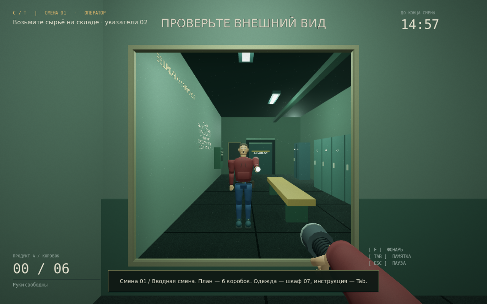
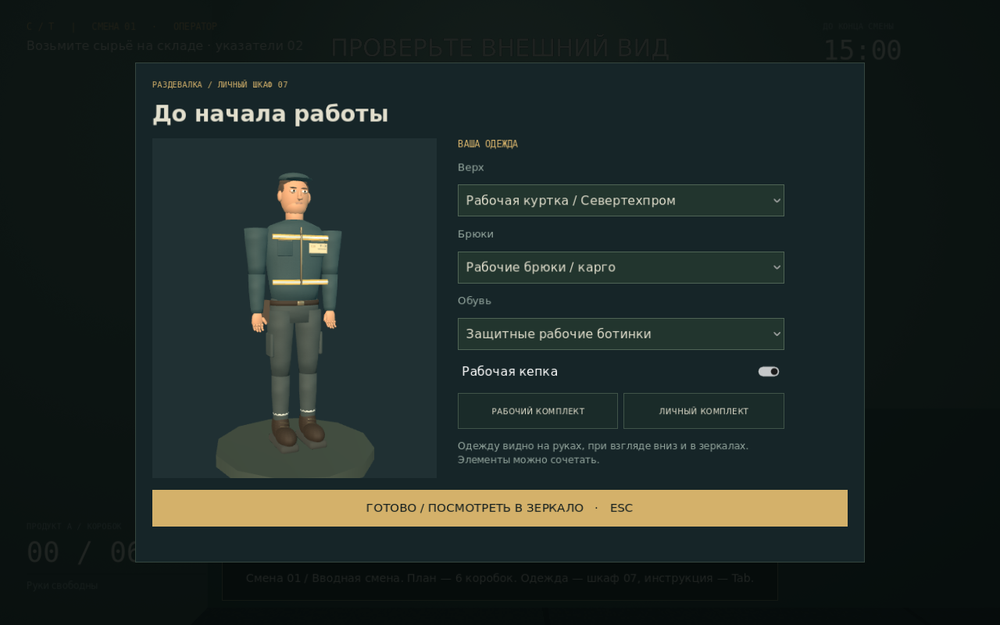

# Смена №13

Версия **0.2** ночного производственного симулятора от первого лица. **Godot 4.6.x, GDScript, PC.** Две смены, текстурированный персонаж, сменная одежда, настоящие зеркала и фонарик с анимацией. Окружение пока использует простые placeholder-модели. В проекте нет обязательных плагинов, SDK, платных ассетов и сетевых сервисов.

## Запустить игру

1. Установите обычный **Godot 4.6.3** (версия .NET не требуется).
2. В менеджере проектов нажмите **Импорт → project.godot → Импортировать и редактировать**.
3. Дождитесь импорта ресурсов. Нажмите **F5 / Запустить проект**.
4. Выберите **НАЧАТЬ СМЕНУ**. Управление и маршрут доступны по **Tab**.

Вручную создавать узлы, назначать скрипты или добавлять Input Actions **не нужно**. Главная сцена уже выбрана: `scenes/main/Main.tscn`. Карта и placeholder-модели создаются при запуске `Factory.tscn`; в редакторе эта сцена выглядит пустой до запуска. Для проверки всей игры используйте **F5**, а не запуск отдельной сцены F6.

Если проект уже скачан через Git, закройте запущенную игру, выполните в папке проекта `git pull origin main` и дайте Godot импортировать новую модель и текстуры. Blender для запуска **не нужен**.

## Персонаж, одежда и зеркала

В раздевалке находятся **два зеркала**: большое в металлической раме у дальней стены и небольшое около выхода. Они отражают настоящий цех, персонажа и его действия; ракурс меняется при движении игрока.

Подойдите к **шкафу 07 / ВАШ ШКАФ** рядом с остальными шкафчиками и нажмите **E**. Появится примерочная с живым 3D-предпросмотром:

- верх: рабочая куртка со светоотражающими полосами или личное бордовое худи;
- брюки: рабочие карго или личные джинсы;
- обувь: рабочие ботинки или личная текстильная обувь;
- головной убор: кепка или без неё.

Можно сочетать элементы или выбрать целиком рабочий / личный комплект. Одежда меняется также на руках от первого лица и на теле при взгляде вниз. Выбор сохраняется **сразу** отдельно от прогресса смены; он также входит в автосохранение. Последний выбранный комплект имеет приоритет при «Продолжить». Во время примерки время остановлено. **Esc** закрывает шкаф.

**Фонарик изначально выключен и закреплён в держателе на поясе.** По **F** персонаж достаёт его правой рукой, поднимает, нажимает кнопку большим пальцем и включает свет. Следующее нажатие F запускает нажатие кнопки выключения и возврат на пояс. На доставание требуется около 0.8 секунды: мгновенного включения до нажатия кнопки нет. Частые нажатия F завершаются в последнем запрошенном состоянии. Эти движения видны в зеркале. Сырьё и продукт переносятся левой рукой; фонарик можно продолжать держать правой.

Зеркала используют отдельную камеру и текстуру отражения, работают в GL Compatibility. Дополнительный проход отключается, когда зеркало за спиной или далеко. Разрешение отражения зависит от качества графики: 256 / 512 / 768 пикселей по высоте. Зеркала друг в друге не отражаются, чтобы избежать бесконечной рекурсии. Модель и анимации стилизованные, без захвата движений.





## Первая смена

План: **6 коробок продукта A**, лимит — **15 минут**. Каждая партия занимает 12 секунд при скорости 1.0×. Смену можно закрыть раньше после выполнения плана.

1. Выходите из раздевалки через дверь в коридор. На склад ведёт дверь **02 / СКЛАД**.
2. На складе посмотрите на тумбу **СЫРЬЁ A / ВЫДАЧА** и нажмите **E**. Коробка появится в руках.
3. Идите в **01 / ЦЕХ**. Слева от М–13 находится жёлтый приёмник: **E** загружает коробку.
4. Справа находится пульт. Нажмите **E**, оставьте **160 °C / 4 бар / 1.0×** и нажмите **START**. **Esc** закрывает пульт. Работа машины и время смены продолжаются при открытом пульте.
5. Через 12 секунд заберите продукт из зелёного лотка перед машиной: **E**.
6. Отнесите его на большой **упаковочный стол** в том же цехе: **E**. Счётчик увеличится на одну коробку.
7. Повторите шесть раз. Вернитесь в раздевалку и нажмите **E** на табельном терминале у стены.
8. Получите расчётный листок. После него игра автоматически сохраняет деньги и номер следующей смены.

**Если случилась авария:** выставьте температуру 130–180 °C, давление 3–6 бар и скорость 0.8–1.2×, затем **RESET → START**. Сырьё и накопленный прогресс сохраняются. **STOP** приостанавливает партию. **RESET** не удаляет готовый продукт. При отключённом питании сначала включите рубильник в технической комнате. Авария даёт штраф $10; повторное нажатие START при уже возникшей аварии не добавляет штрафы.

При выполненном плане выплата: $100 + $40 премии − штрафы. При истечении времени с незакрытым планом: $40 без премии − штрафы. Выплата не бывает отрицательной. Если таймер истёк после выполнения плана, полный заработок сохраняется.

## Вторая смена: «В журнале вас нет»

После первой смены выберите **ПРОДОЛЖИТЬ РАБОТУ** или загрузите сохранение следующей смены. Во второй смене план — **8 коробок**, время — **17 минут 30 секунд**, партия — **10 секунд**. Параметры по умолчанию: **170 °C / 4.5 бар / 1.0×**. План, памятка и пульт показывают параметры текущей смены.

После второй упакованной коробки звонит телефон **на столе в комнате управления**. Поднимите трубку через E. Реплика «Ты сегодня опять остался один?» пока представлена текстом в диалоговом окне; есть звук звонка, отдельной голосовой озвучки нет. После разговора вскоре на пять секунд гаснет освещение, но М–13 продолжает работать. Используйте фонарик. Если проигнорировать звонок, событие произойдёт после четвёртой коробки — производство не блокируется.

На том же столе лежит **архивный журнал, лист 13**. Прочитайте его через E. Найденная запись, ответ / игнорирование телефона и произошедший сбой сохраняются после завершения смены. Чтение приостанавливает время. Освещение восстанавливается автоматически; события не мешают выполнить и закрыть план.

Пока подготовлены именно две смены: после второй можно повторять её производственный профиль с новым номером, без новых сюжетных эпизодов.

## Управление и Input Map

Все действия уже записаны в `project.godot` и используют **физические клавиши**, поэтому работают и на русской раскладке.

| Клавиша | Действие | Input Action |
|---|---|---|
| W / A / S / D | Передвижение | `move_forward`, `move_left`, `move_back`, `move_right` |
| Мышь | Обзор | `InputEventMouseMotion` |
| Shift | Бег | `sprint` |
| Ctrl | Присесть, удерживать | `crouch` |
| E | Дверь, предмет, машина, упаковка, терминал, шкаф, телефон, журнал | `interact` |
| G | Положить переносимый предмет | `drop_item` |
| F | Достать и включить фонарик / выключить и убрать на пояс | `flashlight` |
| Tab | Памятка и маршрут | `tasks` |
| Esc | Пауза / закрыть пульт, настройки, примерку или документ | встроенное `ui_cancel` |

Пауза останавливает время и оборудование. Кнопка выхода в меню предупреждает о потере незавершённой смены. У каждого объекта есть физическая коллизия; взаимодействие работает по лучу длиной 2.8 м и не проходит через стены.

## Что работает в MVP

- Главное меню: новая игра, продолжение, настройки и выход.
- Персонаж: ходьба, бег, физическое приседание с проверкой места над головой, обзор и фонарик.
- Оригинальный GLB-персонаж с текстурами ткани, кожи, джинсов и ботинок; позы рук, ходьба, приседание и анимация фонарика.
- Два настоящих зеркала, примерочная с 3D-предпросмотром, независимая смена элементов одежды.
- Семь помещений: раздевалка, коридор, цех, управление, склад, техническая и закрытая комната №13.
- Открывающиеся двери; единый контракт взаимодействия с подсказками; перенос, падение и повторный подбор физических коробок.
- М–13: загрузка, пульт START / STOP / RESET, температура, давление, скорость, производство и выдача продукта.
- Диагностика перегрева, давления, заклинивания и отсутствия питания; ручной ремонт параметрами и рубильником.
- Упаковка, производственный план, таймер, результаты и расчёт зарплаты.
- Автосохранение после каждой смены; резервная копия; продолжение с начала следующей смены.
- Настройки разрешения, полного экрана, громкости, чувствительности и качества; отдельное сохранение настроек.
- Оригинальные простые звуки, свет, промышленные указатели, текстуры пола и лёгкая виньетка.
- Вторая смена со своим планом, звонком, отключением освещения и читаемым журналом.

**Границы этого этапа:** полная кампания из семи ночей, концовки, магазин улучшений, работающие камеры, случайные поломки и полноценная озвучка пока не реализованы. Мониторы в управлении декоративные. Поломки вызываются неверными параметрами или рубильником. Доступен первый сюжетный эпизод второй смены; комната №13 остаётся закрытой.

## Сохранения

Файлы находятся в `user://`, **не в папке проекта**:

- `shift13_save.json` — номер следующей смены, деньги, улучшения, решения, документы, одежда, последний расчёт;
- `shift13_save.json.bak` — предыдущая целая версия для восстановления;
- `shift13_settings.cfg` — настройки и последний выбранный комплект одежды.

В Windows: `%APPDATA%\Godot\app_userdata\Смена №13\`. Точное расположение можно открыть в редакторе: **Проект → Открыть папку пользовательских данных**. Промежуточного сохранения внутри смены нет. Новая игра заменит прежний прогресс только после окончания новой смены; перед этим меню запрашивает подтверждение.

Сохранения версии 0.1 совместимы: при отсутствии поля одежды применяется сохранённый пользовательский комплект или стандартная рабочая форма.

## Структура

| Папка / сцена | Назначение |
|---|---|
| `scenes/main/Main.tscn`, `scripts/main/Main.gd` | Старт, смена экранов, пауза и связь систем |
| `scenes/world/Factory.tscn`, `scripts/world/Factory.gd` | Карта, мебель, свет, точки производственного маршрута |
| `scripts/world/WorldBuilder.gd` | Повторно используемые примитивы, таблички и материалы |
| `scripts/world/PlanarMirror.gd`, `shaders/mirror.gdshader` | Отражённая камера, перспективная проекция, поверхность зеркала |
| `scenes/player/Player.tscn`, `scripts/player/` | Персонаж, камера, физика и луч взаимодействия |
| `scripts/player/CharacterVisual.gd` | Сборка модульного тела, одежда, позы рук и ног |
| `scripts/player/FlashlightController.gd`, `FlashlightModel.gd` | Доставание, нажатие кнопки, включение и возврат на пояс |
| `assets/character/Worker.glb`, `assets/character/textures/` | Готовая оригинальная модель, ткань, кожа, джинсы и нашивка |
| `scripts/interaction/` | `Interactable.gd`, `CarryItem.gd`, `Door.gd` |
| `scenes/machines/Machine.tscn`, `scripts/machines/` | Машина, состояния, параметры и диагностика |
| `scripts/game/` | Данные игры, производственная смена, `ShiftDefinition.gd` и текущая задача |
| `scripts/story/NightEvents.gd` | Телефон, временное отключение света, архивный журнал и сюжетные флаги |
| `scenes/ui/`, `scripts/ui/` | Меню, настройки, HUD, пульт, результаты, общая тема |
| `scenes/ui/WardrobeMenu.tscn`, `scripts/ui/WardrobeMenu.gd` | Примерочная, выбор элементов и отдельный мир 3D-предпросмотра |
| `scripts/save/SaveManager.gd` | Проверка формата, запись, резервная копия и настройки |
| `scripts/audio/`, `assets/audio/` | Звук и промышленный фон |
| `assets/fonts/`, `shaders/` | Шрифты с кириллицей, пол, плёнка и градиент меню |
| `tests/` | Сквозные проверки настоящих сцен и необязательный захват изображений |

Автозагрузки уже настроены: `Storage`, `Game`, `Audio`. Чтобы добавить интерактивный объект, используйте `Interactable` с коллизией и обработчиком сигнала `interacted(actor)`. Для собственных физических типов поддерживаются методы `get_prompt(actor)` и `interact(actor)` — как у `CarryItem`.

Новые клавиши вводить не нужно: добавленные системы используют прежние `interact` (E), `flashlight` (F) и `ui_cancel` (Esc). Маски рендера: 1 — окружение, 2 — полное тело для отражений, 4 — руки от первого лица, 8 — видимые собственные ноги / пояс, 16 — поверхности зеркал.

Для необязательной переработки исходной модели предусмотрены `tools/art/generate_textures.py` (Python с Pillow и NumPy) и `tools/art/build_worker.py` (Blender 4.3+). Они создают PNG и готовый GLB. Обычное открытие игры использует готовые ресурсы и ничего не генерирует через Blender.

## Экспорт в Windows

В `export_presets.cfg` уже есть профиль **Windows Desktop / x86_64 / Shift13.exe** с встроенным PCK.

1. В Godot откройте **Редактор → Управление шаблонами экспорта** и установите шаблоны **точно для вашей версии Godot**.
2. Откройте **Проект → Экспорт → Windows Desktop**.
3. Создайте папку `builds/windows`, нажмите **Экспорт проекта**, выберите `Shift13.exe`.
4. Для релиза снимите флажок **Экспорт с отладкой**.

При передаче сборки сохраните уведомления из `assets/licenses/` и `assets/fonts/LICENSE-DejaVu.txt` рядом с EXE.

Либо из командной строки после установки шаблонов:

```sh
mkdir -p builds/windows
godot --headless --path . --export-release "Windows Desktop" builds/windows/Shift13.exe
```

Игра использует совместимый OpenGL-рендерер и не требует Vulkan. Экспортный профиль подготовлен; запуск на настоящей Windows-машине и выпуск в Steam нужно проверять отдельно. Steamworks, достижения, подпись исполняемого файла и магазинная страница в MVP не добавлены.

## Проверки

Никаких тестовых плагинов устанавливать не нужно:

```sh
godot --headless --path . --editor --import --quit
godot --headless --path . --fixed-fps 60 --scene res://tests/SmokeRunner.tscn
godot --headless --path . --fixed-fps 60 --scene res://tests/FeatureRunner.tscn
```

Первая проверка запускает настоящие сцены: Input Map, физический луч и дверь, управление, перенос, пульт, неисправность и ремонт, шесть партий, упаковка, зарплата, сохранение, продолжение, пауза, настройки, отключение питания и таймаут. Вторая проверяет модель и текстуры, примерку, геометрию отражения, последовательность работы фонарика, многократные нажатия F, перенос левой рукой, вторую смену, звонок, восстановление света, журнал и совместимость сохранений. Тесты используют собственные файлы с ID процесса и не перезаписывают прогресс игрока. Итоги выводятся строками `RESULT: … checks, … failures`; при ошибке код выхода ненулевой. `tools/check.sh` запускает импорт и оба набора проверок.

Необязательная проверка рендера (нужен графический дисплей):

```sh
godot --path . --scene res://tests/CaptureRunner.tscn
godot --path . --scene res://tests/AvatarCaptureRunner.tscn
```

Скрипты создают PNG меню, игрового вида, пульта, настроек, результатов, зеркал, одежды, фонарика и второй смены в игнорируемой папке `test-results/`. Используются отдельные тестовые сохранения, игровой прогресс не перезаписывается.

## Изменить параметры прототипа

- Планы, длительность, партия и рецепт каждой смены: `scripts/game/ShiftDefinition.gd`.
- Допустимые параметры: `scripts/machines/MachineFailure.gd`.
- Цвета и оформление: `scripts/ui/UIFactory.gd`.

Памятка, табличка оператора и пульт используют профиль текущей смены. После изменения баланса обновляйте также сквозные проверки маршрута и числа производственных циклов.
